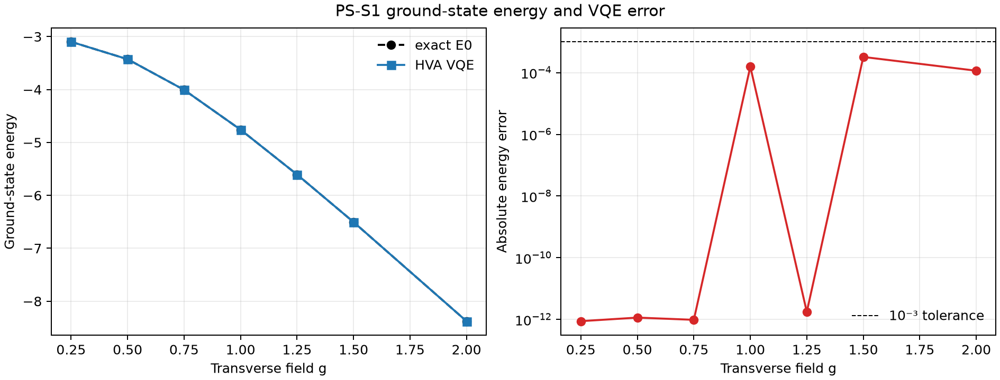
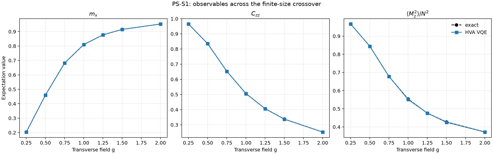
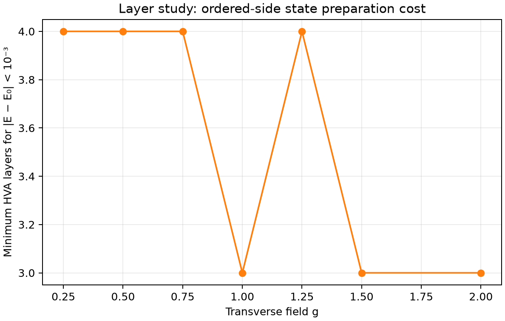
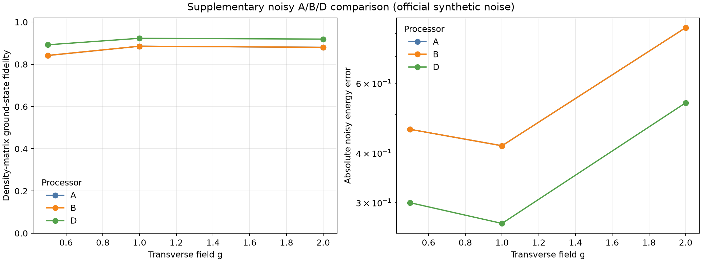
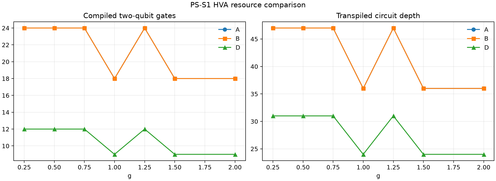
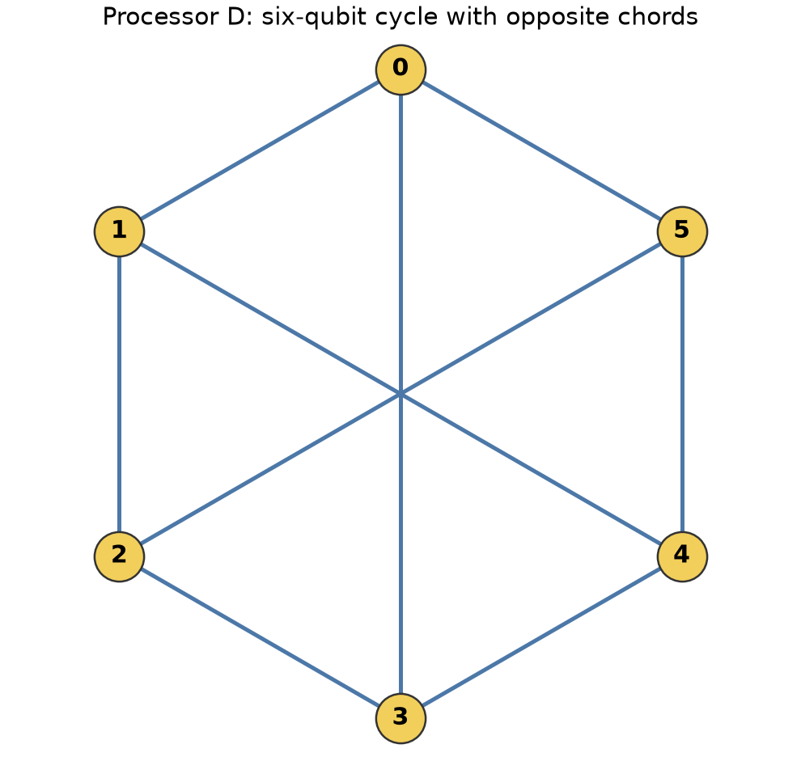
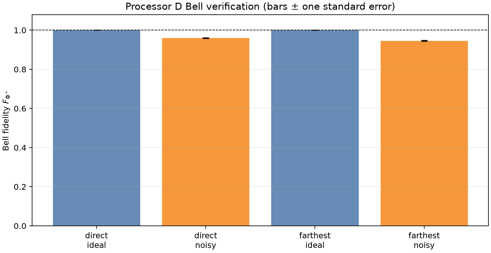

# QFF 2026 Phase 2 — PS-S1 report

**Team:** Chicken Leg Piece  
**Problem:** PS-S1, open-chain transverse-field Ising ground state  
**Status:** local Phase 2 simulation artifacts; the team submits the public repository URL through the hackathon portal.

## Summary

We reproduced the locked N=4 instances at all seven fields, used the HVA with seeds 0, 1 and 2, and recorded the first layer count reaching `|E - E0| < 10^-3` where achieved (search bound L=12). The same logical HVA is compiled on A/B using CX-based ZZ rotations and on D using native RZZ rotations at the same two-qubit error rate. All noisy values are local density-matrix simulations, not hardware measurements.

Minimum-layer outcomes: g=0.25: L=4, g=0.50: L=4, g=0.75: L=4, g=1.00: L=3, g=1.25: L=4, g=1.50: L=3, g=2.00: L=3.

## Why the Ising model matters in real life

The Ising model is a simplified way to describe interacting magnetic moments, or spins, in a material. In this transverse-field version, neighboring spins interact with each other while an external field pushes them toward a different orientation. Changing the field can change the material's magnetic behavior. Quantities such as magnetization and spin-to-spin correlation help describe those changes.

Researchers use related spin models to study magnetism and quantum materials. Better simulations could help explain which magnetic patterns are stable and how a material responds when conditions change. Quantum algorithms such as VQE are being explored as a way to simulate strongly correlated quantum systems, although useful material studies require much larger and more realistic models than this one.

This submission uses only a four-spin chain with synthetic processor noise. It demonstrates a reproducible way to estimate a small Ising ground state and compare circuit costs; it does not predict a specific material or demonstrate a hardware result. The Processor D comparison is about how efficiently this workload maps to a proposed processor design.

## Locked method and references

The Phase 2 specification supersedes Phase 1 inputs: `H = -Σ ZᵢZᵢ₊₁ - gΣXᵢ`, open boundary, `J=1`. Each instance is loaded from `data/s1/`; exact E0 and E1 are checked against dense diagonalization. PS-S1 uses VQE only. Parameter initialization uses `numpy.random.default_rng(seed)` with a uniform draw in `(-π, π)` and the official seeds 0, 1, 2. Each layer has two shared HVA parameters. The layer search runs in increasing L and stops at the first L meeting the energy tolerance; all three seeds are run at each attempted layer. `optimizer_calls` in the CSV is the sum over those three starts.

## N=4 VQE and finite-size crossover

The table reports the best of the three official starts at the selected minimum layer. `F2` sums overlaps with the two lowest exact eigenstates, which is informative where the low-field levels are close. `mz` is the symmetry diagnostic and should remain near zero for a spin-flip-symmetric state.

| g | L | VQE E | E0 | E1 | E−E0 | F | F2 | best seed |
| --- | --- | --- | --- | --- | --- | --- | --- | --- |
| 0.25 | 4 | -3.09788888 | -3.09788888 | -3.09056425 | 8.78e-13 | 1.00000 | 1.00000 | 0 |
| 0.50 | 4 | -3.42703409 | -3.42703409 | -3.33224650 | 1.15e-12 | 1.00000 | 1.00000 | 0 |
| 0.75 | 4 | -4.00581557 | -4.00581557 | -3.67030489 | 9.71e-13 | 1.00000 | 1.00000 | 0 |
| 1.00 | 3 | -4.75861445 | -4.75877048 | -4.06417777 | 1.56e-04 | 0.99997 | 0.99997 | 2 |
| 1.25 | 4 | -5.60598575 | -5.60598575 | -4.49076477 | 1.76e-12 | 1.00000 | 1.00000 | 2 |
| 1.50 | 3 | -6.50356881 | -6.50389156 | -4.93747511 | 3.23e-04 | 0.99995 | 0.99995 | 0 |
| 2.00 | 3 | -8.37668321 | -8.37679864 | -5.86584451 | 1.15e-04 | 0.99999 | 0.99999 | 2 |

| g | mx (VQE) | mx (exact) | Czz (VQE) | Czz (exact) | mz²/N² (VQE) | mz²/N² (exact) | mz (VQE) | mz (exact) |
| --- | --- | --- | --- | --- | --- | --- | --- | --- |
| 0.25 | 0.20351 | 0.20351 | 0.96479 | 0.96479 | 0.96676 | 0.96676 | +1.39e-17 | +9.20e-14 |
| 0.50 | 0.46013 | 0.46013 | 0.83559 | 0.83559 | 0.84460 | 0.84460 | +0.00e+00 | -3.33e-15 |
| 0.75 | 0.68213 | 0.68213 | 0.65314 | 0.65314 | 0.67818 | 0.67818 | +0.00e+00 | +2.21e-15 |
| 1.00 | 0.81060 | 0.81010 | 0.50540 | 0.50613 | 0.55134 | 0.55358 | +0.00e+00 | +1.76e-15 |
| 1.25 | 0.87742 | 0.87742 | 0.40629 | 0.40629 | 0.47619 | 0.47619 | +0.00e+00 | +1.04e-17 |
| 1.50 | 0.91528 | 0.91503 | 0.33730 | 0.33791 | 0.42576 | 0.42752 | +1.39e-17 | -8.57e-16 |
| 2.00 | 0.95254 | 0.95250 | 0.25211 | 0.25228 | 0.37177 | 0.37235 | +0.00e+00 | -3.33e-16 |

### Seed consistency at the selected layer

The next table shows each of the three required random starts at the selected layer for each field. The best-seed row above remains the requested headline result; these rows show the spread behind that selection.

| N | g | L | seed | VQE E | |E−E0| | tolerance met | calls |
| --- | --- | --- | --- | --- | --- | --- | --- |
| 4 | 0.25 | 4 | 0 | -3.09788888 | 8.78e-13 | yes | 630 |
| 4 | 0.25 | 4 | 1 | -3.08284516 | 1.50e-02 | no | 423 |
| 4 | 0.25 | 4 | 2 | -3.08284516 | 1.50e-02 | no | 369 |
| 4 | 0.50 | 4 | 0 | -3.42703409 | 1.15e-12 | yes | 504 |
| 4 | 0.50 | 4 | 1 | -3.34060799 | 8.64e-02 | no | 585 |
| 4 | 0.50 | 4 | 2 | -3.34060799 | 8.64e-02 | no | 513 |
| 4 | 0.75 | 4 | 0 | -4.00581557 | 9.71e-13 | yes | 675 |
| 4 | 0.75 | 4 | 1 | -3.97642305 | 2.94e-02 | no | 666 |
| 4 | 0.75 | 4 | 2 | -4.00581557 | 2.07e-12 | yes | 657 |
| 4 | 1.00 | 3 | 0 | -4.73530411 | 2.35e-02 | no | 392 |
| 4 | 1.00 | 3 | 1 | -4.74229277 | 1.65e-02 | no | 483 |
| 4 | 1.00 | 3 | 2 | -4.75861445 | 1.56e-04 | yes | 504 |
| 4 | 1.25 | 4 | 0 | -5.60598575 | 4.30e-12 | yes | 2529 |
| 4 | 1.25 | 4 | 1 | -5.60598575 | 2.26e-11 | yes | 3330 |
| 4 | 1.25 | 4 | 2 | -5.60598575 | 1.76e-12 | yes | 684 |
| 4 | 1.50 | 3 | 0 | -6.50356881 | 3.23e-04 | yes | 1407 |
| 4 | 1.50 | 3 | 1 | -6.50095868 | 2.93e-03 | no | 707 |
| 4 | 1.50 | 3 | 2 | -6.50000986 | 3.88e-03 | no | 476 |
| 4 | 2.00 | 3 | 0 | -8.37572435 | 1.07e-03 | no | 567 |
| 4 | 2.00 | 3 | 1 | -8.37603247 | 7.66e-04 | yes | 952 |
| 4 | 2.00 | 3 | 2 | -8.37668321 | 1.15e-04 | yes | 798 |

The exact observables show the finite-size crossover: transverse magnetization grows as g increases, while nearest-neighbour Z correlation and squared longitudinal magnetization decrease. Across the locked grid, `mx` has the largest end-to-end change (about 0.75), narrowly ahead of `Czz` (about 0.71); `mz2` remains a useful finite-size order parameter. At finite N this is a smooth crossover rather than a sharp thermodynamic phase transition. The measured layer counts are four for g≤0.75 and three at g=1.0, 1.5 and 2.0, with g=1.25 also requiring four; this is a general low-field increase, not a strictly monotone curve. On the ordered side the state needs strong long-range Z correlations, while the HVA starts in the transverse-field product state |+〉^N, so extra alternating entangling/rotation layers are needed to build those correlations.

## Noisy Processor D results

The required noisy PS-S1 run uses the selected converged circuit at g=0.5, 1.0 and 2.0. The density matrix includes gate noise and excludes readout noise, as specified for the fidelity definition.

| g | L | noisy energy | noisy F | mx | Czz | mz²/N² |
| --- | --- | --- | --- | --- | --- | --- |
| 0.50 | 4 | -3.127356 | 0.89245 | 0.42822 | 0.75697 | 0.78234 |
| 1.00 | 3 | -4.493048 | 0.92313 | 0.76870 | 0.47275 | 0.52951 |
| 2.00 | 3 | -7.841449 | 0.91927 | 0.89310 | 0.23222 | 0.36197 |

### Supplementary noisy A/B/D comparison

This extra density-matrix comparison uses the same selected ideal HVA parameters for each field on A, B, and D, with the official per-gate noise model and no readout noise. It is supplemental context; the required Phase 2 noisy result above remains the Processor D result.

| processor | g | L | compiled 2q | noisy energy | noisy F | mx | Czz |
| --- | --- | --- | --- | --- | --- | --- | --- |
| A | 0.50 | 4 | 24 | -2.968167 | 0.84174 | 0.41042 | 0.71578 |
| B | 0.50 | 4 | 24 | -2.968167 | 0.84174 | 0.41042 | 0.71578 |
| D | 0.50 | 4 | 12 | -3.127356 | 0.89245 | 0.42822 | 0.75697 |
| A | 1.00 | 3 | 18 | -4.341620 | 0.88566 | 0.74443 | 0.45463 |
| B | 1.00 | 3 | 18 | -4.341620 | 0.88566 | 0.74443 | 0.45463 |
| D | 1.00 | 3 | 9 | -4.493048 | 0.92313 | 0.76870 | 0.47275 |
| A | 2.00 | 3 | 18 | -7.548563 | 0.88037 | 0.86032 | 0.22200 |
| B | 2.00 | 3 | 18 | -7.548563 | 0.88037 | 0.86032 | 0.22200 |
| D | 2.00 | 3 | 9 | -7.841449 | 0.91927 | 0.89310 | 0.23222 |

Across these three fields, A and B overlap in this locked setup. D uses half as many compiled two-qubit gates and reaches higher simulated density-matrix fidelity at each sampled field. This is a result under the supplied synthetic model, not a hardware-performance claim.

## Processor D and architecture comparison

D is a six-qubit cycle with opposite chords and native RZZ. It contains a four-qubit cycle, retains the open-chain path needed by PS-S1, and supports the optional N=6 instances. The Phase 1 supplementary ring ansatz measured five routing SWAPs on A and none on B. For the Phase 2 HVA, A/B use the official CX basis, requiring two CX gates for each ZZ rotation; D uses one RZZ at the same p2=0.005. The extra couplers and calibration burden are a trade-off; crosstalk is not represented by the supplied depolarizing noise model.

Average N=4 metrics across the seven selected HVA circuits (the detailed per-field records are in `results/tables/resources.csv`):

| processor | physical qubits | mean logical 2q | mean compiled 2q | mean depth | mean routing SWAPs |
| --- | --- | --- | --- | --- | --- |
| A | 5.0 | 21.4 | 21.4 | 42.3 | 0.0 |
| B | 9.0 | 21.4 | 21.4 | 42.3 | 0.0 |
| D | 6.0 | 10.7 | 10.7 | 28.0 | 0.0 |

## Common Bell-state objective

We prepare `|Φ+>` on one directly coupled D pair and one farthest-apart pair. Each row pools the three measured Pauli bases with 4,096 shots per basis. The fidelity is `F=(1+XX−YY+ZZ)/4`; the standard error propagates the three independent parity-estimator errors in quadrature.

| pair | physical qubits | distance | condition | XX ± SE | YY ± SE | ZZ ± SE | F ± SE |
| --- | --- | --- | --- | --- | --- | --- | --- |
| direct | 0-1 | 1.0 | ideal | +1.0000 ± 0.0000 | -1.0000 ± 0.0000 | +1.0000 ± 0.0000 | 1.0000 ± 0.0000 |
| direct | 0-1 | 1.0 | noisy | +0.9463 ± 0.0051 | -0.9468 ± 0.0050 | +0.9463 ± 0.0051 | 0.9598 ± 0.0022 |
| farthest | 0-2 | 2.0 | ideal | +1.0000 ± 0.0000 | -1.0000 ± 0.0000 | +1.0000 ± 0.0000 | 1.0000 ± 0.0000 |
| farthest | 0-2 | 2.0 | noisy | +0.9238 ± 0.0060 | -0.9141 ± 0.0063 | +0.9458 ± 0.0051 | 0.9459 ± 0.0025 |

## Reproducibility and limits

The required gates, noise parameters, shot count, seeds, and transpilation settings are supplied by the unchanged `qff_sim.py`. The tables are generated by `scripts/run_phase2_s1.py`; `main.ipynb` loads the checked-in tables by default and can recompute them with `RECOMPUTE = True`. Processor D is validated with `tools/check_processor_d.py`. The full result is limited to the small locked model and synthetic noise; it establishes no hardware advantage. AI assistance is disclosed in `AI_DISCLOSURE.md`.

